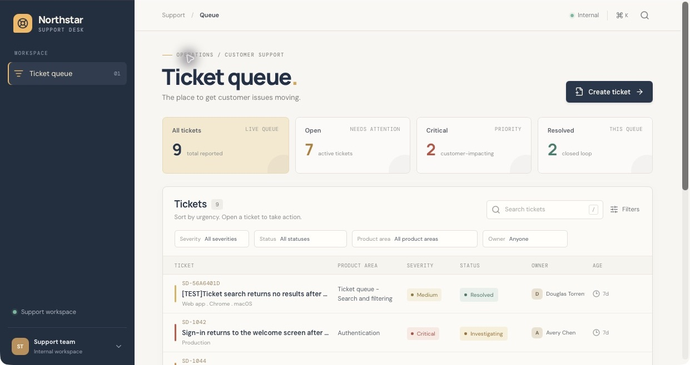
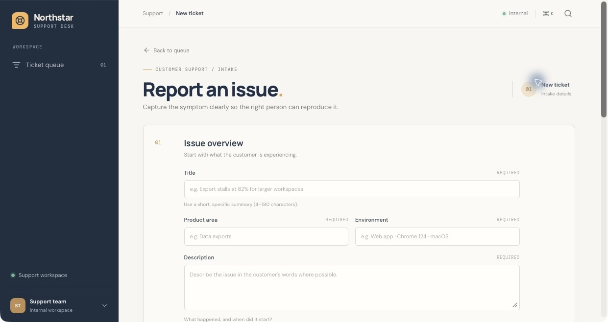
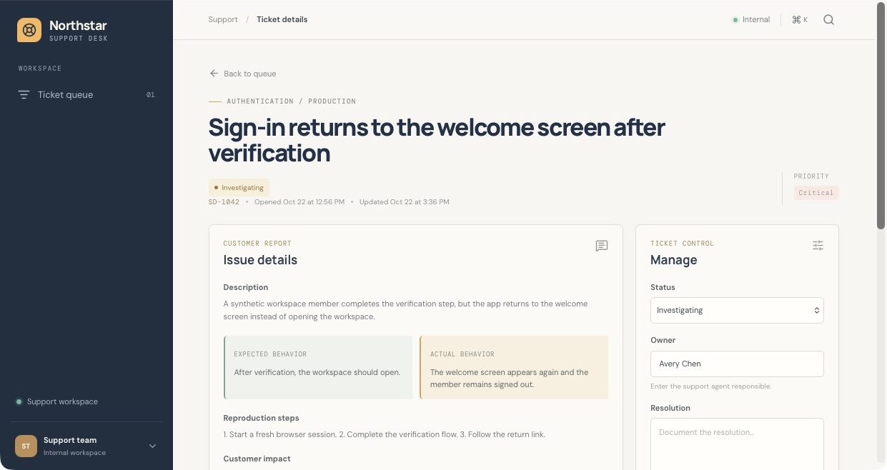

# Northstar Support Desk

A support operations workspace for turning a technical issue into a clear, actionable ticket—from intake and triage through investigation and resolution.

**Created by [Douglas Torrentes](https://www.linkedin.com/in/douglastorrentes/) with Replit Agent.** My work focused on defining the support workflow, directing the build, exercising the application, investigating reported behavior, and documenting the evidence.

[Replit project](https://replit.com/@dtorrentes31/Support-Ticket-Hub) · [QA case study](docs/QA_CASE_STUDY.md) · [Application source](artifacts/support-desk/src/App.tsx) · [API routes](artifacts/api-server/src/routes/tickets.ts)

The screenshots provide a walkthrough without requiring workspace access. The Replit project may require sign-in; a public deployment has not been verified.



## Why I built it

Technical support needs both careful troubleshooting and useful internal tools. I built Northstar to practice the complete support workflow: collect enough detail to reproduce an issue, assess impact, assign ownership, record findings, and close the loop with a documented outcome.

This portfolio project uses synthetic example tickets and a clearly marked QA ticket. It demonstrates a working support workflow; it does not represent production customer support volume or business impact.

## What it does

- **Structured intake:** captures the environment, expected and actual behavior, reproduction steps, customer impact, severity, and optional sanitized logs, with request validation.
- **Queue triage:** combines search with severity, status, product-area, and owner filters, including an explicit Unassigned option.
- **Ownership and lifecycle:** generates ticket identifiers and stores owner, status, resolution, and timestamps in PostgreSQL.
- **Investigation history:** records investigation, troubleshooting, customer-update, and resolution notes with an author label and timestamp.
- **Operational summaries:** shows total tickets, active tickets, active critical tickets, and resolved/closed tickets.
- **Responsive interface:** provides queue, detail, and intake views with loading, error, and empty-result states.

## Screenshots

### Structured ticket intake

The intake form guides the reporter toward a reproducible issue rather than an incomplete symptom report. Additional sections below the pictured overview collect expected/actual behavior, reproduction steps, impact, and evidence.



### Investigation and ownership

The detail view brings the report, expected/actual behavior, severity, owner, and lifecycle controls into one workspace. The activity log below the report preserves troubleshooting and communication history.



Screenshots were captured from the running development app on October 29, 2026, with browser controls cropped out. The queue contains eight seeded examples plus one resolved QA ticket; a fresh database starts with eight examples. The names and incidents in the seeded tickets are fictional.

## A support investigation worth reviewing

I used the app to investigate a report that clearing the Critical filter left the queue empty. A controlled browser run traced the filter state, query key, outgoing request, API response, and rendered results.

Clearing the filter issued `GET /api/tickets`, returned **HTTP 200 with 9 records**, and immediately rendered all 9 without a refresh or component remount. Other filter-clear, search-preservation, Reset, and Unassigned-owner checks also passed. The reported defect could not be reproduced, so it was closed with the evidence and conditions for reopening. No production fix was claimed or applied.

Read the [case study and repeatable check list](docs/QA_CASE_STUDY.md) for the investigation, rejected hypothesis, results, and testing limits.

## Technology and architecture

| Layer | Implementation |
| --- | --- |
| Interface | React 19, TypeScript, Vite 7, Tailwind CSS 4, Wouter |
| Server state | TanStack Query 5 and generated API hooks |
| API | Express 5, Zod validation, Pino logging |
| Persistence | PostgreSQL and Drizzle ORM |
| API contract | OpenAPI, with Orval-generated client and validation packages |
| Workspace | Node.js 24 and pnpm; developed on Replit |

```text
React interface → generated API client → /api ticket routes → PostgreSQL
                         ↑                     ↑
                     OpenAPI contract → generated validation
```

The interface accesses the database through the API. The query parameters are validated before server-side filtering, and ticket activity is stored separately from the ticket record.

## Run in Replit

The current workspace is configured for **Replit / Linux x64**. Its dependency overrides exclude native binaries for other platforms, and Replit supplies the shared-origin routing between the web app and API.

1. Import this repository into Replit with Node.js 24 and pnpm available.
2. Provision a development PostgreSQL database and make its connection string available as `DATABASE_URL` through Replit Secrets or the database integration.
3. From the repository root, install dependencies and apply the schema to that development database:

   ```bash
   pnpm install
   pnpm --filter @workspace/db run push
   ```

4. Run the API Server and Support Desk web workflows. Their package commands are:

   ```bash
   pnpm --filter @workspace/api-server run dev
   pnpm --filter @workspace/support-desk run dev
   ```

   The API service requires a `PORT`. The web service requires its own `PORT` and `BASE_PATH` (`/` for the root). Configure these per workflow; the services must use distinct internal ports. Route `/api` to the API service and `/` to the web service through the workspace router, then open the Support Desk preview.

5. On the first queue request, an empty ticket table is seeded with eight synthetic examples. Existing records are preserved.

For a standalone environment, supply equivalent same-origin routing: the Vite config currently has no `/api` proxy, and the API does not serve the web build. A portable local development configuration is future work.

### Available checks

Run from the workspace root in the configured environment:

```bash
pnpm run typecheck
pnpm run build
```

When changing the OpenAPI contract, regenerate the client and validation packages:

```bash
pnpm --filter @workspace/api-spec run codegen
```

These are type/build checks. The repository currently has **no automated test suite or test script**. The case study records browser-based regression checks performed during the original investigation; it is not an automated test report.

## Repository guide

| Path | Purpose |
| --- | --- |
| [`artifacts/support-desk`](artifacts/support-desk) | React interface and app-specific technical notes |
| [`artifacts/api-server`](artifacts/api-server) | API routes, logging, and synthetic demo data |
| [`lib/db`](lib/db) | Database connection and Drizzle schema |
| [`lib/api-spec/openapi.yaml`](lib/api-spec/openapi.yaml) | API contract |
| [`lib/api-client-react`](lib/api-client-react) | Generated API hooks |
| [`lib/api-zod`](lib/api-zod) | Generated validation |
| [`docs/QA_CASE_STUDY.md`](docs/QA_CASE_STUDY.md) | Investigation evidence and manual regression scenarios |
| [`docs/screenshots`](docs/screenshots) | Real screenshots of the running app |

## Current scope and next improvements

The current app is a demonstration workspace with editable owner/author labels. Authentication, role-based permissions, SLA tracking, and live push updates are not implemented. Use synthetic data while evaluating it.

Planned improvements:

- Add authenticated support-agent access and authorization checks.
- Establish automated coverage for filter resets and ticket lifecycle behavior.
- Require closure evidence consistently when resolving a ticket.
- Add a portable local development setup and a public demo with appropriate access controls.

## Contact

[Douglas Torrentes on LinkedIn](https://www.linkedin.com/in/douglastorrentes/) · [GitHub](https://github.com/dtorrentes)
